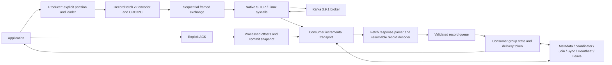

# Native Kafka architecture audit

Audit date: 2026-11-15 (Asia/Shanghai). Repository: `/root/shuwen/s`.
Scope: read existing implementation, execute diagnostics, update documentation; no
Producer, Consumer, compiler or runtime implementation changes. Evidence directory
`E = .bootstrap/kafka-audit/audit-20261115/` below the repository root. Initial HEAD,
dirty inventory and source hashes are in `E/head.txt`, `initial-status.txt` and
`source.sha256`. Preexisting uncommitted Kafka files are part of the audited input.

## Data and control flow

Group membership is a control plane: it establishes ownership before Fetch and
also services heartbeats between transport/decode steps. It does not wait until
after record decoding to join a group. ACK and OffsetCommit are distinct actions.

## Components and public interfaces

| Component | Source / functions | Behavior and ownership |
| --- | --- | --- |
| Data model | `src/std/kafka/config.s`: `endpoint`, `nullable_bytes`, `message`, `header`, `produce_result` | Binary strings with explicit null presence; offset/partition output fields; legacy `config` is not the Consumer config or the Producer API's ACK default. |
| Producer | `produce.s`: `producer_open`, `producer_publish`, `producer_publish_batch`, `producer_close` | One owning socket, one outstanding synchronous request; endpoint supplied by application must lead the requested partition. |
| Broker | `broker.s`: `broker_connect`, `broker_api_versions`, `broker_send_request`, `broker_close`, `_k_exchange` | Request header v1, response correlation header v0, 1 MiB cap, IDs 1..INT32_MAX with wrap; malformed/transport failure closes connection. |
| Shared wire primitives | `protocol.s`: `writer`, `cursor`, `put_*`, `read_*`, `take`, `finished`, `crc32c` | Bounded lengths, signed big-endian integers, zigzag varints, null/empty separation and Castagnoli CRC. Compact/tag helpers exist but do not establish flexible API support. |
| Producer record codec | `batch.s`: `encode_record_batch`, `validate_record_batch` | Uncompressed magic-2, nontransactional/nonidempotent; validator accepts Producer-format batches, not general broker Fetch data. |
| Consumer configuration/state | `consumer_types.s`: `consumer_config`, `consumer`, `consumer_new` | Defaults and bounds, no I/O at construction; state exposed in `consumer`. One owner; copying or concurrent calls unsupported. |
| Consumer orchestration | `consumer.s`: `consumer_subscribe`, `consumer_service`, `consumer_close`, `_kc_service_once`, `_kc_recover`, `_kc_revoke` | Explicit topic list once per instance, cooperative service, eager revocation/rejoin, reconnect, session/max-poll checks, periodic metadata. |
| Incremental I/O | `consumer_transport.s`: `consumer_link`, `consumer_exchange_begin`, `consumer_exchange_step`, `_kc_body_append`, `_kc_body_collect` | Four role links: bootstrap/metadata, group, heartbeat, Fetch. One request per role; fragmented reads/writes survive short caller budgets. |
| Discovery | `consumer_metadata.s`, `consumer_group_protocol.s`: `consumer_build_metadata`, `consumer_parse_metadata`, `consumer_build_find`, `consumer_parse_find` | Multiple bootstrap endpoints, metadata broker list, leader/coordinator lookup; all resolved hosts must still be literal IPv4. |
| Group assignment | `consumer_assign.s`: `consumer_range_assign`, subscription/assignment codecs; `consumer_group_protocol.s`: Join/Sync/membership codecs | Classic eager Range, sorted members/partitions per topic, handles heterogeneous subscriptions and empty assignment. |
| Fetch and decoding | `consumer_fetch.s`: `consumer_build_fetch`, `consumer_parse_fetch`; `consumer_decode.s`: `consumer_decoder_new`, `consumer_decoder_step` | One partition per Fetch; isolation=0; full validation before delivery, 4096 CRC bytes or up to 32 records per decoder step. |
| Delivery and seek | `consumer_poll.s`: `consumer_poll`, `_kc_fetch_step`, `consumer_seek` | One outstanding delivery token globally; bounded application batch; seek discards queued deliveries and invalidates epochs. |
| ACK/commits | `consumer_ack.s`: `consumer_ack`, `consumer_commit_candidates`, `consumer_apply_commit`; `consumer_offset_state.s`: `consumer_commit`, `_kc_commit_step`, `_kc_initial_offsets` | Fetch, delivery, processed and confirmed positions separated. OffsetCommit only uses processed-valid candidates. |
| Diagnostics | `consumer_describe.s`: `consumer_build_describe`, `consumer_parse_describe` | DescribeGroups codec and test helper, not a full AdminClient. |
| OS transport | `src/std/tcp.s`: `dial_ipv4`, `read_some`, `_bytes`, `write_some`, `close` | Native syscall boundary; received byte array converted to string by balanced recursive assembly. No Kafka TLS/SASL adapter. |

All unqualified source names above are under `src/std/kafka/`. Full function inventory:
`E/functions.txt`. Runnable examples: `test/kafka/producer/main.s`,
`test/kafka/consumer-phase1/main.s`, `consumer-offsets/main.s`, and
`consumer-benchmark/main.s`. These are test-oriented programs with fixed fixture
ports and assumptions, not general deployment clients.

## Connection and scheduling lifecycle

Producer opens TCP, negotiates ApiVersions v0, requires Produce v3, then serializes
and sends explicitly chosen batches. Local invalid input preserves connection and
correlation. An ambiguous timeout/write failure is returned without retry; reopening
is the application's responsibility. Valid Kafka errors preserve the connection.
Open's connect and negotiation each have a timeout; the publish exchange timeout
starts after serialization, so this is not a whole-call CPU deadline.

Consumer states are 0=new, 1=Metadata, 2=FindCoordinator, 3=JoinGroup,
4=leader metadata union, 5=SyncGroup, 7=offset initialization, 6=stable,
9=terminal, 10=max-poll expired, 11=coordinator retry/heartbeat validation.
`consumer_new` validates locally; subscribe starts discovery. Each active role
negotiates required versions before use. `_kc_service_once` prioritizes heartbeat,
then group/discovery/offset/commit work. Poll additionally runs Fetch and decoding.
Short poll/service deadlines do not cancel an in-flight RPC. Connect attempts are
bounded by caller, ownership and heartbeat deadlines; decoder/parse CPU work still
needs latency qualification at maximum bounds.

There is no background thread. Call poll regularly and call service during batch
processing. `consumer_ack` itself does not check the clock: see finding C-01.
Close may commit ACKed data if auto-commit is enabled, attempts LeaveGroup within
the remaining close budget, then closes all four role sockets. It is idempotent;
Leave errors remain observable. A closed object does not clear every retained
managed field: see M-02.

## Buffers and allocation

A Consumer exchange retains outgoing bytes, a size header, body fragments and
assembled body. Reads are capped at 1024 bytes. Binary-carry fragment assembly has
logarithmic levels and avoids a single deep concatenation chain. Completion clears
fragment levels but keeps the body until a later request or close. `take` uses
`__string_slice`; canonical codegen copies slices and flat concatenations, whereas
Seed uses its separate string/runtime representation. Neither is evidence of zero
copy. TCP's `int[]` receive boundary and conversion create additional allocations.

The decoder holds its input cursor, CRC slice, current record cursor and complete
validated output. `_kc_fetch_step` transfers output into `c.queue` and resets the
decoder on success. `max_poll_records` bounds a delivery, not total decoded storage.
Queue and delivery state are bounded by frame and record-count caps; total process
memory is not thereby bounded. ACK releases the outstanding token, not all runtime
allocations; commit retains a small partition snapshot.

Canonical executables include the nonmoving conservative mark/sweep allocator in
`src/runtime/native_gc.c`, emitted by `amd64_record_allocator` in
`src/cmd/compile/internal/codegen/amd64_program.s`. Slabs start at 1 MiB,
collection is allocation-triggered (minimum 32 MiB period), and only completely
empty slabs are unmapped. Stack/register/global roots and size-class fragmentation
can retain memory; an idle wait or close does not force collection.

Seed standalone executables use `s_alloc` in
`src/runtime/selfhost_linux_amd64.S`: aligned bump allocation using `brk`.
`standalone_analyze_regions` and `emit_region_loop` in
`src/cmd/compile/seed/code/standalone_amd64_backend.c` allow selected effect-free
regions to rewind/promote live results. Mutable borrowed Consumer loops do not
have a general tracing collection guarantee. Distinct allocator paths explain why
compiler compatibility is not memory-behavior equivalence. See measured results in
[KAFKA_MEMORY_AUDIT.md](KAFKA_MEMORY_AUDIT.md).

## Architecture findings

| ID / status / severity | Evidence and current behavior | Missing behavior | Recommended action |
| --- | --- | --- | --- |
| A-01 / PASS / informational | Above source call paths and fresh executable evidence; pure native S Kafka client with no external Kafka client linkage. Java is local broker/admin/independent test input only. | No cross-platform qualification. | Retain explicit Linux/amd64/plaintext/IPv4 scope. |
| A-02 / PARTIAL / P1 | `consumer_poll.s::_kc_fetch_step`: one partition per request, one active Fetch role; group state uses linear/nested scans. | Multi-broker pipelined Fetch and realistic partition-scale evidence. | Qualify fairness/latency at 1/16/128+ partitions before adding pooling. |
| A-03 / PARTIAL / P1 | `consumer_transport.s::consumer_exchange_step`, `tcp.s::_bytes`, codegen allocation behavior and RSS measurements. | Allocation budgets and proven sustained memory bounds for each compiler. | Address M-01 before advanced protocol work. |

Build entry: `misc/scripts/build-kafka-broker-test.sh` compiles the test entry point,
all Kafka S files, TCP/time/result/prelude, and emits standalone executables.
`build-kafka-test.sh` is an older mixed bridge path with obsolete modes; prefer the
broker builder. The repository's lowercase `makefile` contains compiler/bootstrap
and broad test recipes, but no Kafka target (`rg -n kafka makefile` has no matches).
The stock benchmark mode has a duplicate-main wildcard failure, T-01.
