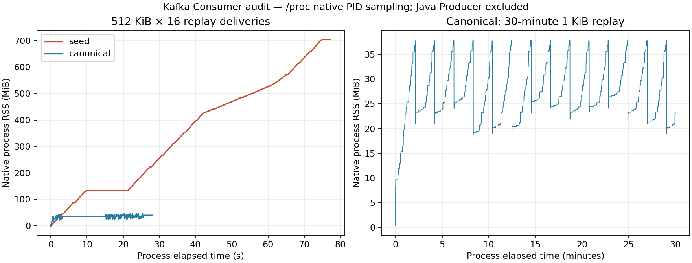

# Consumer memory audit

Date: 2026-11-15. Evidence root:
`.bootstrap/kafka-audit/audit-20261115/` (`E` below).
Status: **FAIL for Seed unbounded-workload suitability; PARTIAL for general native
Consumer memory qualification**. Severity **P0 release gate** (M-01). No memory
fix, compiler/runtime rewrite, cap increase or new Kafka feature was implemented.

## Experimental method

Controlled input sizes: 1 KiB, 16 KiB, 64 KiB, 256 KiB, 512 KiB and 1 MiB.
Both Seed and canonical compiled the same audit-only Consumer harness,
`E/memory.s`, against the current `src/std/kafka/*.s`, TCP/time/result/prelude.
Compiler hashes match the identity table in the capability matrix. Source and
binaries, build logs, runner, sampling code and independent input program remain
in E. The initial harness compilation failures are transcribed in
`E/harness-build-attempts.md`; these are not Kafka acceptance failures.

An owned Kafka 3.9.1 cluster (two brokers, one controller, ports 39092/39093/39094)
uses the existing repository Corretto runtime, process-local 512 MiB heaps and
8 MiB log-cleaner dedupe buffers. No Java/system installation. Each size/compiler
has a fresh one-partition topic with replica assignment `1:2`. Topic
`max.message.bytes=2097152` and the independent Java Producer's
`max.request.size=2097152` allow a full 1 MiB input to reach Kafka, so the client
cap test is not mistaken for a server-side input rejection. `E/produce-*.log`
records acknowledged offset 0 and exact size.

**No Producer allocation is inside the measured native process.** The existing
Kafka Java library is used only in `E/AuditProducer.java`, a separate test-input
process. It emits uncompressed bytes `x`; the native harness checks value length
and first/last bytes, ACKs, commits and explicitly seeks to offset 0 to replay.
This size harness is not a complete per-byte oracle; separate Producer/Consumer
acceptance tests supply stronger exact-field/content checks.

For each supported size, the native process completes 16 deliveries, manual ACKs
and commits. At delivery 3 it deliberately stops service for 11 seconds, observes
session loss/revocation, rejoins/restores and seeks to replay. It emits checkpoints
before setup, on the first three delivered/ACK/commit steps, before/after session
revocation, after rejoin, before close, after close, after resetting the Consumer
value and after two idle seconds. Checkpoints sleep 100 ms for sampling. Resetting `c` does not clear every
application stack local: the last returned batch/record can still be reachable
when the final RSS is sampled. Therefore that point is object reset plus idle,
not proof that no application references remain. This
qualifies session-loss rejoin memory, not an independently triggered multi-member
rebalance memory profile.

The size sweep deliberately sets `request_timeout_ms=30000`,
`max_poll_records=1`, `fetch_max_bytes=786432` (default) and
`max_poll_interval_ms=60000`. It does not certify the default 5000 ms request
budget for large records. A hard guard kills a measurement over 2000 seconds or
1,800,000 KiB RSS; no successful size case hit that guard.

`E/measure.py` samples the **native PID** every approximately 50 ms using
`/proc/<pid>/status` (VmRSS, VmHWM, VmSize, RssAnon, RssFile), `/proc/<pid>/stat`
(CPU time), and FD counts. It snapshots `smaps_rollup` about every ten seconds.
Samples and event times are in each case's `samples.json`; stdout is retained.
Post-checkpoint values below use the first sample >=30 ms after the event, inside
the 100 ms checkpoint pause. The first sample after exec is not confused with a
warm steady-state baseline. Kernel socket buffers are not measured native heap;
Java broker RSS is excluded. Other audit jobs share the host.

## Source and allocation investigation

| Area / status | Source / function | Current behavior and evidence | Missing behavior / severity / action |
| --- | --- | --- | --- |
| Fetch buffers / PARTIAL | `consumer_transport.s::consumer_exchange_begin`, `consumer_exchange_step`, `consumer_link_close` | Outgoing/header/body/fragment fields reset at exchange start; fragment array cleared after body assembly; complete body remains until next exchange/close. <=1 MiB frame. | Per-exchange allocation accounting/reuse; P1; profile/reset owned buffers without invalidating decoder views. |
| Balanced fragment assembly / PASS for depth, PARTIAL memory | `consumer_transport.s::_kc_body_append`, `_kc_body_collect`; `test/kafka/consumer-unit/transport.s` | Binary-carry levels give logarithmic depth; total copied/allocated bytes and intermediate objects still exist. | No implication of constant total allocation or general reclamation; P1; measure flat vs rope allocation/copy costs independently. |
| TCP conversion / PARTIAL | `src/std/tcp.s::read_some`, `_bytes`; TCP receive intrinsic | `int[]` receive becomes strings through balanced byte-string concatenation, per <=1024-byte read. | Large transient allocation per payload; P1; bounded byte-buffer/streaming transport design before optimization. |
| Slice storage / PARTIAL | `protocol.s::take`; `amd64_program.s::amd64_emit_string`/string_slice emission; Seed runtime | Canonical slices copy; Seed uses separate runtime/string graph. Small field references need not imply small backing storage in every runtime. | Whole response/record reachability accounting; P1; avoid universal zero-copy/backing-release claims. |
| Record arrays / PARTIAL | `consumer_decode.s::consumer_decoder_step`; `consumer_poll.s::_kc_fetch_step`, `consumer_poll` | Validates then accumulates <=4096 records, transfers queue, resets decoder on successful completion. Returned batch limit does not prevent whole-response decoding. | Bounded delivery windows and allocation-friendly arrays; P1; test maximum small-record counts and large-message mixtures. |
| ACK/delivery / PASS logical bounds, PARTIAL reclamation | `consumer_ack.s::consumer_ack`; Consumer outstanding fields | One outstanding delivery globally; token cleared after ACK; queue cleared on drain. | Clearing token/queue is not allocator reclamation; P1/M-01; measure ownership beyond logical state. |
| Commit state / PARTIAL | `consumer_offset_state.s::_kc_begin_commit`, `_kc_commit_step`; `consumer_ack.s::consumer_apply_commit` | Partition-only snapshot; confirms only successful responses; snapshot remains after success/close. | Clear obsolete references, bounded partition-scale measurement; P2/M-02. |
| Rebalance/close / FAIL cleanup completeness | `consumer.s::_kc_revoke`, `consumer_close` | Links/queue/assignment cleared, but decoder and other managed state not comprehensively reset. Probe retains 65,536 decoder bytes after close on all five paths. | Mid-decode cancellation and retained-field cleanup; P2/M-02; test live partial decode, not only synthetic construction. |
| Canonical allocator / PARTIAL qualification | `src/runtime/native_gc.c::s_native_gc_alloc`, `collect`, `add_slab`; `amd64_program.s::amd64_record_allocator` | Conservative nonmoving mark/sweep; allocation-triggered >=32 MiB period; wholly empty slabs unmapped. Confirmed symbols in actual executable. | Stale conservative roots/slab fragmentation and workload-dependent plateau remain possible; P1; instrument live bytes and isolate allocation stages. |
| Seed allocator / FAIL sustained suitability | `src/runtime/selfhost_linux_amd64.S::s_alloc`, `s_region_return`; `standalone_amd64_backend.c::standalone_analyze_regions`, `emit_region_loop` | `brk` bump allocator; selected effect-free arenas can rewind/promote, mutable Consumer paths have no general tracing GC. Actual Seed binary exports s_alloc/region helpers, not native GC. Size sweep shows payload-dependent persistent growth. | Reclamation/ownership for effectful long-lived paths; P0; do not assume canonical GC applies to Seed binaries. |
| Socket ownership / PASS sampled scope | `consumer_link_close`, `broker_close`, `tcp.close`; process FD samples | Owning sockets closed; repeated-close safe; samples expose native FD count. | Long multi-member/failover FD stress beyond current measurements; P2; separate FD leakage from heap growth. |

## Findings and interpretation

**M-01 — runtime-dependent retained allocation (P0).** Seed shows a large,
payload-dependent retained anonymous-memory increase even with one queued record,
one outstanding delivery, repeated ACK/commit and final object reset. Thus the
observed Seed behavior is not explained by a bounded 16-record live application
cache. Source inspection supports non-reclaimed allocation on the effectful bump
allocator path. This is not proof of a single forgotten Kafka pointer; allocation
policy and transient graph copies are contributing mechanisms. Attribute exact
bytes by transport/decoder/state only after dedicated allocation instrumentation.

Canonical's much smaller measured footprint is consistent with allocation-triggered
collection/slab retention. Lack of an immediate RSS drop after ACK/commit/close is
not by itself proof of a leak: those calls neither force GC nor unmap partially
live slabs. Conversely, a finite plateau for one workload does not prove absence
of leaks, especially across more partitions, payload distributions, rebalance
patterns, compression or stale conservative roots.

**M-02 — retained transient state on lifecycle transitions (P2).** The deterministic
probe constructs pending decoder input and a snapshot, then closes without an
owned socket: `closed_decoder_bytes=65536`, `closed_commit_snapshot=1`, close
error=0. All five compiler paths reproduce it. This demonstrates bounded stale
references in a closed Consumer; it does not alone explain the size sweep's
hundreds of MiB. Correct cleanup and allocator reclamation are separate work.

**C-03 — hard size/record caps (P1).** The 1 MiB case reaches Kafka but fails locally
with `error=2 native=0 consumer response frame cap` under both compilers. The
harness deliberately exits 4 after recording terminal/cleanup checkpoints.
This is **NOT successful 1 MiB consumption**. ACK/commit/rebalance checkpoints are
not applicable for that rejected input. The separate 4160-record/37,248-byte
valid decoder probe also fails error_bounds. Do not remove caps without a memory
budget and bounded decoder design.

## Measurement tables and sustained result

The generated tables below contain the actual retained `/proc` results. Raw logs,
checkpoint JSON, CSV/plots and workload caveats remain available for independent
reanalysis. A durable fresh-output wrapper is in
[`audit-tools/reproduce-memory.py`](audit-tools/reproduce-memory.py); exact original
runner, source and logs remain in E. Run
`python3 doc/kafka/audit-tools/reproduce-memory.py .bootstrap/kafka-audit/NEW_MEMORY_RUN`
from the repository root with the documented prerequisites.

### Size sweep

All memory values in KiB; initial is before Consumer setup. “Delivered/ACK/commit”
columns refer to the first delivery of the replay workload; final before-close and
post-cleanup cover all 16 completed deliveries. Events for deliveries 2/3 and
session loss/rejoin are in `E/memory-checkpoints.json`. Peak is sampled RSS, with
status high-water values retained separately in that JSON.

| Payload | Compiler | Exit / status | Initial | First delivered | After ACK | After commit | After revoke / rejoin | Peak | Before close | After close | Reset + idle |
| --- | --- | --- | ---: | ---: | ---: | ---: | ---: | ---: | ---: | ---: | ---: |
| 1 KiB | seed | 0 / PASS scoped replay | 172 | 3672 | 3672 | 4008 | 4976 / 10032 | 16200 | 16108 | 16176 | 16200 |
| 1 KiB | canonical | 0 / PASS scoped replay | 4056 | 9896 | 9896 | 9896 | 9896 / 9896 | 12272 | 12272 | 12272 | 12272 |
| 16 KiB | seed | 0 / PASS scoped replay | 172 | 4028 | 4032 | 4148 | 7696 / 12576 | 35628 | 35544 | 35604 | 35628 |
| 16 KiB | canonical | 0 / PASS scoped replay | 4060 | 10956 | 10956 | 10956 | 13068 / 13068 | 30756 | 30756 | 30756 | 30756 |
| 64 KiB | seed | 0 / PASS scoped replay | 172 | 8180 | 8180 | 8284 | 20088 / 25152 | 101828 | 101744 | 101804 | 101828 |
| 64 KiB | canonical | 0 / PASS scoped replay | 4060 | 15444 | 15444 | 15444 | 23892 / 26004 | 37420 | 37420 | 37420 | 37420 |
| 256 KiB | seed | 0 / PASS scoped replay | 172 | 24648 | 24648 | 24752 | 69700 / 74788 | 366788 | 366704 | 366764 | 366788 |
| 256 KiB | canonical | 0 / PASS scoped replay | 4060 | 28908 | 28908 | 28908 | 28544 / 28544 | 42616 | 32204 | 32204 | 32204 |
| 512 KiB | seed | 0 / PASS scoped replay | 172 | 46704 | 46704 | 46808 | 135960 / 141044 | 720932 | 720848 | 720908 | 720932 |
| 512 KiB | canonical | 0 / PASS scoped replay | 4060 | 29292 | 29292 | 29292 | 36456 / 36456 | 49096 | 40812 | 40812 | 40812 |
| 1024 KiB | seed | 4 / NOT IMPLEMENTED at size | 168 | — | — | — | — | 2576 | — | — | 2576 |
| 1024 KiB | canonical | 4 / NOT IMPLEMENTED at size | 4060 | — | — | — | — | 9636 | — | — | 9636 |

The 512 KiB Seed case lasted 77.4 seconds including the intentional 11-second
service lapse and checkpoints; canonical lasted 28.1 seconds. These are replay
completion times, not isolated throughput or default-timeout latency. All sizes
through 512 KiB completed 16 deliveries; native Producer payload/request overhead
was bypassed only by the independent Java input process.

### Completed 30-minute canonical run

Status **PARTIAL for sustained consumption/RSS measurement; FAIL for final close**.
The native process ran for
1800.91 seconds, with 2332 complete 1 KiB replay deliveries,
ACKs and commit calls, and one deliberate session-loss/rejoin cycle. The 1800-second
condition is measured inside the native loop, not inferred from a timeout or
broker uptime. Process exit was **13**, the harness branch for a nonzero
`consumer_close` result. It completed the timed consumption loop but did not
emit closed/reset/idle checkpoints. No sustained clean-shutdown PASS is claimed. `E/memory-sustained/samples.json` contains
35,828 samples.

| Checkpoint | Native RSS KiB | Anonymous KiB | FD count |
| --- | ---: | ---: | ---: |
| initial | 4052 | 3952 | 3 |
| delivered | 9900 | 9472 | 7 |
| ack | 9900 | 9472 | 7 |
| commit | 9900 | 9472 | 7 |
| revoked | 9900 | 9472 | 3 |
| rejoined | 10956 | 10528 | 6 |
| before-cleanup | 23908 | 23480 | 7 |
| closed | — | — | — |
| cleanup | — | — | — |
| idle-after-cleanup | — | — | — |

Peak sampled RSS: **38,908 KiB (38.00 MiB)**.
Last sampled native CPU time: 1.76 seconds.
Final ten-minute sampled RSS range: **18.96–37.89 MiB**;
least-squares slope **-0.5254 MiB/minute** over those samples.

| Elapsed consumption window | Samples | RSS min MiB | RSS mean MiB | RSS max MiB |
| --- | ---: | ---: | ---: | ---: |
| 0–5 min | 5972 | 0.35 | 24.35 | 37.77 |
| 5–10 min | 5959 | 18.91 | 27.19 | 38.00 |
| 10–15 min | 5960 | 18.96 | 26.22 | 37.93 |
| 15–20 min | 5973 | 22.04 | 27.76 | 37.80 |
| 20–25 min | 5973 | 21.01 | 29.22 | 37.89 |
| 25–30 min | 5972 | 18.96 | 25.67 | 37.79 |

Interpretation: the final-window measurements must be read as a finite observed
trend, not a zero-growth guarantee or proof of leak freedom. This low-rate replay
keeps input size and broker backlog fixed, repeatedly exercising Fetch/decode,
seek, ACK and commit. It does not exercise a continuous independent input stream,
many partitions, many members, sustained 512 KiB records, or 30 minutes under Seed.
The Seed size sweep and allocator source already establish a separate retention
problem; the canonical experiment cannot clear that finding. Follow-up acceptance
must use fresh data and agreed deployment load/limits across compiler paths.

Standalone [PDF figure](KAFKA_MEMORY_RSS.pdf). Raw data: per-case `samples.json`,
`E/memory-checkpoints.json`, `E/rss-sustained.csv` and ten-second `smaps-*.txt`.
Post-close FD/RSS for the sustained run are unavailable because the harness
returned immediately on close failure; table dashes mean unmeasured. Short size
cases did measure close/reset. The close call's detailed returned error was not
logged by this harness, so its cause remains unresolved (R-02). The enclosing
runner exits 0 after recording child exit 13; its wrapper status must not override
`memory-status.tsv` or the child's samples. A repeat needs explicit close error
code/native code/message and membership/heartbeat state logging.

## Remaining work and recommended next action

Prioritize M-01 allocation/lifetime correctness, then M-02 transient-reference
cleanup and C-03 bounded decoding. Keep the current reproduction as a baseline.
Instrument allocation counts/live bytes and compare transport-only, decoder-only,
empty-poll, commit and rebalance workloads before selecting a fix. A local bounded
byte-buffer/ownership design and Seed runtime reclamation have different scope;
neither should be replaced by raising caps or assuming ACK frees the heap.

**Not executed in this audit:** thirty minutes for each payload/compiler pair;
continuous newly produced traffic; RSS after independent multi-member rebalance;
forced-GC/live-object accounting; maximum-count adversarial memory/latency tests;
and host-isolated steady-state comparisons. These are PARTIAL qualification gaps,
not tests claimed PASS. No unavailable compiler path was silently skipped.

## R-02 follow-up: real remote-idle close failure

The 30-minute harness did not print its returned close error. A separate controlled
real-broker experiment used new owned ports 49092/49093/49094 and a copied broker
helper setting **connections.max.idle.ms=5000**. An audit copy of the existing
`consumer-group/main.s` heartbeat scenario kept stable membership for 14 seconds,
then printed the close error. Both Seed and canonical built successfully, retained
stable generation 1, and returned **close_code=4, native=104, consumer read/EOF**;
each client exited **8** at the close assertion. The outer runner/tool session
subsequently reported exit 143 during fixture shutdown (`E/idle-close-run.exit`);
no successful outer-suite exit is claimed. See
`E/idle-close-{seed,canonical}.log`, `idle-close-status.tsv`, the generated source,
compiler logs and complete broker logs. Startup coordinator/connection retry errors
in the Seed log are retained; they do not invalidate the subsequently stable
membership and explicit close failure.

Source trace: `_kc_link_ready` trusts connection.state==2 plus a populated versions
array, which cannot detect a peer's idle FIN without I/O. `consumer_close` reconnects
if the socket is locally known closed or a request is pending, but does not retry
Leave after discovering remote EOF during its exchange. Membership heartbeats
continue through their separate socket. Repeated identical offset commits in the
long replay are no-ops once the position is confirmed, so its group socket can
remain idle. This makes idle closure a supported explanation for the sustained
failure; the original close error was not logged, so exact causal attribution for
that run remains an inference. No client fix was made during the audit.

Status **FAIL**, severity **P1**. Next action: a bounded, ownership-safe reconnect
and Leave retry for eligible remote-close errors, tested with real idle sockets,
then rerun sustained cleanup with structured close diagnostics. A shorter test
that explicitly closes the socket locally does not cover this remote-FIN case.
