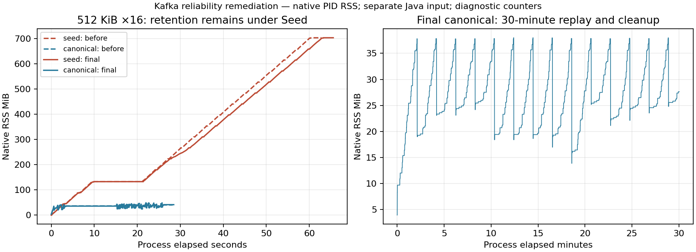

# NeurX S Kafka reliability remediation

Date: 2026-11-15, Asia/Shanghai. Repository: `/root/shuwen/s`.

**Release status: NOT Production Ready.** Close/revocation defects are addressed;
Seed's unbounded-workload memory gate remains unresolved. No release tag,
new Kafka feature, compiler implementation change or system Java installation was
made. This report supplements the preserved capability audit; it does not rewrite
historical outcomes.

Evidence root **E**: `.bootstrap/kafka-remediation/run-20261115T130925Z/`.
`head.txt`, `initial-status.txt`, `initial.diff`, `before.tar.gz` and `before.sha256`
identify the exact dirty starting tree, including untracked implementation files.
A commit SHA alone does not identify these sources. `audit-evidence.sha256` protects
the previous audit's raw evidence; final source/compiler hashes accompany the
regression results below. Final verification and the execution ledger remain in E.

## Root causes and fixes

### Remote-idle, FIN/RST and coordinator loss

**Root cause.** `consumer.s::_kc_link_ready` checks local broker state and negotiated
versions. A peer FIN/RST does not update that cached state until socket I/O detects
it. The old `consumer_close` attempted LeaveGroup once; its reconnect path handled
only a connection already known closed or an incompatible pending RPC. Thus a
remotely idled group socket looked ready, then failed during write/read, and close
returned EOF/reset without attempting a fresh membership exchange. Heartbeats on
the separate heartbeat role could keep membership healthy while the group RPC
socket became idle. This is protocol/connection lifecycle behavior shared by Seed
and canonical, rather than a Seed-only TCP failure.

**Before evidence.** Fresh native peer fixtures in `E/close-red/` built under both
compilers. FIN, RST, lost Leave response, coordinator loss and expired membership
all produced client exit 4. Normal close and error cases also exposed retained
transient state (exit 7). Logs preserve actual native/Kafka error codes. Historical
real remote-idle failures remain under `.bootstrap/kafka-audit/audit-20261115/`.

**Fix.** `consumer.s::_kc_close_leave_once`, `_kc_close_coordinator` and
`consumer_close` implement at most three Leave attempts within **one** caller
budget. A stale transport is closed and the known coordinator is retried first;
further transport failure or retriable coordinator error can trigger bounded
FindCoordinator through configured bootstrap endpoints. Close never rejoins or
starts Metadata/JoinGroup/SyncGroup to manufacture a clean departure. Every
reconnect/negotiation/exchange consumes the same deadline. Caller timeout and
unavailable coordinator remain visible errors, followed by unconditional cleanup.

A valid LeaveGroup UNKNOWN_MEMBER_ID (25) now means the requested absence is already
satisfied, including session expiration or a lost response after a successful
Leave. This exception applies only to LeaveGroup. It does not make stale commits
or other broker errors successful. Authorization, malformed framing/body,
unsupported versions and nonretriable errors remain visible and are not hidden by
retry. Commit failure, when close attempts auto-commit, remains the returned error;
`leave_error` separately records the Leave result. Repeated close remains safe.

**Review correction.** A fresh reviewer found that successful discovery after the
last permitted failed Leave could overwrite the error with success. The new
`redirect-loop` test returned client exit 3 before the fix. The final-attempt guard
preserves the last Leave failure and never reports discovery alone as successful
departure. See `E/redirect-red/` and final close regression evidence.

**TCP/deadline inspection.** `broker.s::broker_close` and `tcp.s::close` consume
single-owner descriptor ownership, including close errors; they do not retry a
possibly reused FD. `consumer_exchange_step` preserves incremental write/read
state, monotonic deadlines, frame/correlation validation, and fatal link closure
on EOF/reset/malformed framing. These transport semantics were retained. The fix
is in close orchestration, not socket-global liveness guesses or Producer retries.
The budget bounds attempts and I/O; it is not a hard real-time guarantee against
scheduler pauses or bounded parser/GC CPU work. The new deadline fixture also
covers auto-commit consuming most of close's budget.

### Managed resource lifecycle

**Root cause.** Closing role links and clearing assignment/queue did not clear
`decoder`, `commit_snapshot`, outstanding token boundaries or all other
Consumer-owned aggregate state. Revocation similarly left a partially validated
Fetch decoder reachable. Logical socket closure was therefore not equivalent to
releasing managed references.

**Fix.** `consumer_close` clears decoder input/output, queue, commit snapshot,
assignment, joined-member metadata, discovered metadata, subscription copies,
coordinator/member state and delivery/commit ownership fields, whether Leave
succeeds, times out or returns an error. Configuration and useful close diagnostics
are preserved. `consumer_link_close` resets outgoing/header/body/fragment storage,
negotiation and exchange fields after consuming socket ownership. `_kc_revoke`
also discards decoder/snapshot/queued and outstanding-delivery state before rejoin.
This does not invalidate a batch value already owned by application code.

**Review correction.** Max-poll expiration now closes/resets the bootstrap role
and clears its operation, matching session expiration. Previously a partial
Metadata/FindCoordinator reply could survive state 10 and be interpreted after
polling resumed in a different state. The seeded pending-bootstrap regression
failed exit 112 before this correction and passed afterward.

**Scope boundary.** A terminal state 9 does not automatically destroy every role
or ownership field before explicit close. This preserves the existing
seek-after-out-of-range contract. Callers must close terminal consumers. The
change guarantees cleanup at close and relevant revocation transitions; it does
not silently redesign every terminal-error recovery policy.

### ACK and poll expiry fencing

`consumer_ack` previously checked token/epoch/state without consulting current
local session/max-poll deadlines. Poll also rejected an outstanding token before
checking liveness. `consumer_ack` now runs the ownership deadline check first;
poll checks liveness before its outstanding-delivery guard. Expiration revokes the
token and transient state before either operation can advance processing. The
new regression failed exit 111 against the old behavior, then passed. Existing
ACK/commit offset and generation-fencing assertions remain in place. Synthetic
offset unit fixtures now initialize valid clocks/configuration for the public ACK
contract rather than depending on zero deadlines.

## Memory amplification investigation

### Measurements and instrumentation

The before/after workload uses the same audit harness: independent official Java
production into an owned Kafka 3.9.1 cluster; native Consumer PID measurement;
16 seek/replay deliveries per supported size, explicit ACK/commit, one deliberate
11-second service lapse/rejoin, close, object reset and idle checkpoints. Sizes:
1/16/64/256/512 KiB and 1 MiB. The request budget is deliberately 30 seconds;
this is not default-deadline performance qualification. The last application batch
can remain a stack root after resetting the Consumer.

`test/kafka/consumer-memory/measure.py` samples `/proc/<pid>/status`, stat CPU time,
FD counts and smaps_rollup, and reads diagnostic counters from the measured child
via `/proc/<pid>/mem`. Exact binaries/sources and counter symbols are retained.
`instrument.py` modifies **diagnostic-only copies/generated assembly**:

- Seed: counts allocation calls, requested/aligned bytes and region returns;
  also samples `s_heap_current`/`s_heap_limit`.
- Canonical: counts requested/rounded allocation and collections, and records
  conservatively retained object bytes at the last collection.

No checked-in compiler/runtime implementation is altered. Counters add arithmetic
and storage but do not implement collection, reuse buffers or change the workload.
Cumulative allocation bytes include memory later reclaimed/reused: they are not
simultaneously live bytes or RSS. Canonical's retained-object counter is a
conservative GC result, not a precise semantic reachability oracle. Seed has no
comparable tracing-live counter; its zero collection count must not be described
as a measurement of zero live memory.

### Located amplification mechanism

The source/runtime and executable disassembly agree:

1. `tcp.s::read_some` receives an `int[]`, then `_bytes` recursively assembles byte
   strings. `_bytes` passes the entire array to each recursive call.
2. The actual Seed binary's `s_fn__bytes` calls `s_value_snapshot` on that array
   before both recursive calls. `s_value_copy_impl` in
   `selfhost_linux_amd64.S` recursively copies array elements. This causes a large
   by-value snapshot cost even though each call needs a smaller range.
3. Pure-function regions reclaim many of these temporaries. Returned rope strings
   still contain many concatenation nodes, and stateful Consumer paths use the
   bump allocator without general tracing reclamation. A bounded queue or clearing
   a field therefore does not imply bounded retained process memory.
4. Canonical uses flat strings/slice copies and allocation-triggered conservative
   mark/sweep. Its cumulative allocation, retained objects and RSS differ sharply.

`E/tcp-bytes-seed.disassembly.txt` contains the actual recursive snapshot calls.
The component experiment (`components.s`) holds payload size at 512 KiB and repeats
16 times, comparing fragment assembly alone, direct incremental decoding, and
TCP-style conversion plus assembly. Setup is excluded from counter deltas. Full
payload equality is checked, and both compilers execute identical S source.

This separates deep-fragment concerns from allocation lifetime: balanced fragment
assembly limits rope depth, but cannot reclaim process-lifetime allocations or
eliminate recursive array snapshots in a lower layer. Decoder slices copy bytes;
ACK and commit snapshots are primarily partition/delivery metadata. Kernel socket
buffers and Java broker memory are outside the measured native RSS.

**Conclusion:** lifecycle cleanup is fixed, but the Seed memory-amplification gate
is not resolved by this patch. The evidence does not justify calling every retained
byte a live-record leak, nor claiming bounded sustained memory. A related byte-buffer/
ownership or Seed reclamation design is follow-up work; unrelated compiler
components were not changed to disguise the result. No additional Kafka feature
should be enabled on the assumption that memory qualification passed.

## Regression interpretation and preservation

The final ledgers below distinguish native TCP peers from actual Kafka brokers.
Intentional SIGKILL=137 in edge tests is an expected condition only when followed
by the required successful restart/replay assertions. A successful wrapper exit
never overrides a failed child or a source-integrity failure.

Every available requested compiler path is built/executed independently. Identical
later-stage compiler hashes are recorded as such; they are not evidence of five
different code generators or a fresh bootstrap. No release-readiness claim follows
from functional acceptance alone.

Historical evidence is retained. Failed/superseded attempts are not reclassified:

- Initial close peer RED and liveness RED results are preserved.
- First borrowed whole-record cleanup spelling failed Seed/canonical compilation;
  explicit field assignments resolved the language constraint.
- The first real close test used an indexed array literal unsupported by Seed;
  binding the topic to a local corrected the test, without changing assertions.
- An early broad run failed unit exit 74 because an old orphan-member fixture
  assumed discovery could not reach a real broker. After adding discovery, an
  already-absent member legitimately returns success. The fixture now uses a
  deterministic invalid address to test unavailable discovery and cleanup.
- Early measurement/matrix workers built before review fixes reported source hash
  changes when the working source was updated. Their binaries/results remain
  identified by their captured pre-fix hashes; final-source gates are separate.
- One intermediate memory fixture could not bind port 39092. Its broker logs and
  failed exit remain; it is not a Consumer failure or successful measurement.
  Final measurements use a fresh owned port range.
- A compiler-recipe harness initially failed to interpret a leading environment
  assignment. Completed checks/logs were retained; the corrected driver resumes
  remaining commands with explicit environment handling and records every exit.
- The benchmark builder now selects the intended `main.s`, avoiding the audit's
  duplicate-main glob failure. The separate simulator is preserved; no assertion
  in the actual benchmark or acceptance matrix is removed.

## Reproduction

Use a fresh output directory every time, with the existing repository Java/Kafka
cache and loopback permissions. Shared peer port 19092 means peer suites run
serially. The real runners own their fixture processes and write only repo-local
artifacts.

```sh
bash misc/scripts/check-kafka-consumer-close.sh NEW_PEER_DIRECTORY
KAFKA_CLOSE_REAL_PORT=62092 bash misc/scripts/check-kafka-consumer-close-real.sh NEW_REAL_DIRECTORY
KAFKA_MEMORY_PORT=61092 bash misc/scripts/check-kafka-consumer-memory.sh NEW_MEMORY_DIRECTORY
bash misc/scripts/check-kafka-memory-components.sh NEW_COMPONENT_DIRECTORY
KAFKA_SUSTAINED_PORT=60092 bash misc/scripts/check-kafka-consumer-sustained.sh NEW_SUSTAINED_DIRECTORY
```

The regression orchestration uses retained output-isolated copies of the existing
Producer/broker scripts so their historical paths are never overwritten; exact
commands and all exits are in E. Ordinary current Consumer acceptance is now
runnable with `check-kafka-consumer-acceptance.sh NEW_DIRECTORY`.

## Before/after measurements

All values below are fresh diagnostic runs, not substituted historical numbers.
The pre-fix binaries were built before library edits; their captured source hashes
and the initial archive identify the inputs. The pre-fix wrapper's final source
check detected subsequent edits while its already-built native programs ran; this
is preserved as a superseded wrapper failure, not a native measurement PASS.
The final size sweep's source-integrity check passes against final library source.

| Payload | Compiler | Before peak RSS KiB | After peak RSS KiB | Before / after cumulative rounded allocation MiB | After last GC-retained bytes / collections | Native child before / after |
| --- | --- | ---: | ---: | ---: | ---: | --- |
| 1 KiB | seed | 20300 | 24196 | 364.33 / 374.17 | not available / no tracing GC | 0 / 0 |
| 1 KiB | canonical | 12280 | 12316 | 4.28 / 4.31 | 0 / 0 | 0 / 0 |
| 16 KiB | seed | 36384 | 36904 | 4281.78 / 4282.38 | not available / no tracing GC | 0 / 0 |
| 16 KiB | canonical | 30760 | 30796 | 24.75 / 24.79 | 0 / 0 | 0 / 0 |
| 64 KiB | seed | 101808 | 101876 | 16891.55 / 16891.61 | not available / no tracing GC | 0 / 0 |
| 64 KiB | canonical | 37548 | 37872 | 93.83 / 93.86 | 1256032 / 2 | 0 / 0 |
| 256 KiB | seed | 366728 | 366516 | 67334.67 / 67334.37 | not available / no tracing GC | 0 / 0 |
| 256 KiB | canonical | 42580 | 41604 | 370.58 / 370.62 | 4290544 / 11 | 0 / 0 |
| 512 KiB | seed | 720564 | 720656 | 134532.37 / 134532.48 | not available / no tracing GC | 0 / 0 |
| 512 KiB | canonical | 48876 | 50388 | 754.28 / 754.32 | 7447168 / 23 | 0 / 0 |
| 1024 KiB | seed | 2580 | 2596 | 13.25 / 13.23 | not available / no tracing GC | 4 / 4 |
| 1024 KiB | canonical | 9640 | 9676 | 0.47 / 0.49 | 0 / 0 | 4 / 4 |

Child exit 4 at 1 MiB is the same explicit response-frame-cap rejection before
and after, **not successful consumption**. A 1 MiB value plus protocol overhead
exceeds the client frame cap. No record/frame cap was raised, no malformed batch
was silently skipped and no ACK was invented. These compatibility limits remain.

For 512 KiB, Seed still retains about 704 MiB at the end of the short replay;
canonical remains around 48–49 MiB peak. Allocation-counter deltas and RSS vary
slightly with scheduling/service work on a shared host. The patch repairs object
reference ownership and close behavior; it does not repair the Seed allocator's
retained-RSS policy or TCP byte-conversion amplification.

### Isolated component allocation

16 iterations × 512 KiB logical payload. Counter deltas run from `ready` to the
16th completed iteration; setup is excluded. RSS is the process's sampled peak,
which does include setup. Cumulative allocation may greatly exceed both live data
and RSS because pure-region temporaries are reclaimed/reused.

| Compiler | Component | Rounded allocation delta MiB | Sampled peak RSS KiB | RSS increase at final iteration KiB | Last conservatively GC-retained bytes |
| --- | --- | ---: | ---: | ---: | ---: |
| seed | fragments | 1.64 | 10068 | 1676 | not available |
| seed | decode | 32.21 | 41272 | 32884 | not available |
| seed | tcp-bytes | 133825.51 | 272084 | 263688 | not available |
| canonical | fragments | 163.87 | 35452 | 4316 | 4992656 |
| canonical | decode | 65.19 | 50772 | 7612 | 11563920 |
| canonical | tcp-bytes | 515.87 | 29036 | 6524 | 4785856 |

The Seed `tcp-bytes` component alone accounts for roughly 131 GiB of cumulative
allocation for 8 MiB logical data. Its much smaller retained RSS proves that
cumulative allocation is not a live-memory measurement. The difference from the
full ~704 MiB case also shows that no one component's retained bytes can simply
be added to another experiment's RSS. Repeated state copies, transport allocation
and runtime lifetime policy interact. The actual full-run canonical last-GC
retained bytes are far below its process RSS, consistent with allocator slabs,
collection timing, conservative roots and live application data.

## Five-compiler identities and test evidence

| Path | SHA256 of invoked compiler |
| --- | --- |
| seed | `f677296274cc4d586bcc8eecf939a01b2a478fe311d2ab2ac5556a053bb49c37` |
| canonical | `783cedef0da1cca00330f51a23646846f518649d287d227f876e812eabad4e73` |
| stage2 | `783cedef0da1cca00330f51a23646846f518649d287d227f876e812eabad4e73` |
| stage3 | `783cedef0da1cca00330f51a23646846f518649d287d227f876e812eabad4e73` |
| stage4 | `783cedef0da1cca00330f51a23646846f518649d287d227f876e812eabad4e73` |

Canonical and Stage2/3/4 are byte-identical binaries. Each executable path is still
invoked separately against current Kafka sources and produces its own artifacts,
build logs and runtime checks. Seed uses a different runtime/allocation path.
This is not a fresh compiler/bootstrap convergence claim.

Final sources are fingerprinted in `E/final-source.sha256`; all production
runtime/compiler files are checked against `before.sha256`. Exact build artifacts,
commands, exits, peer JSON/wire events and actual broker logs are retained rather
than summarized into an unsupported “all tests” statement.

## Review, scope decisions and remaining gates

A fresh read-only reviewer checked the implementation delta against the captured
dirty baseline. No Critical finding was reported. Two Important findings were
reproduced and corrected: exhausted redirects returning success (RED client exit
3), and a pending bootstrap operation surviving max-poll revocation (RED unit exit
112). Their covering tests pass after correction. Malformed/auth discovery and
shared auto-commit close-budget cases were also added to the final peer suite.

Scope decisions are explicit:

- Work in the requested dirty checkout using recoverable snapshots, rather than a
  clean worktree that would omit the uncommitted implementation. Cost: reviewers
  must use the before archive/source manifest rather than HEAD alone.
- Preserve state-9 seek recovery and require explicit close for terminal consumers.
  Cost: a terminal object can retain state until its owner closes it; broad
  automatic revocation would change out-of-range recovery semantics.
- Do not treat successful functional tests or one canonical RSS plateau as a Seed
  memory fix. Cost: the P0 unbounded-workload gate remains open and no Production
  Ready/release claim is made.
- Later compiler stages may be byte-identical, but each path is still executed.
  Cost: this qualifies invocation compatibility, not independent compiler designs
  or fresh source-to-bootstrap convergence.

Remaining limitations:

1. **P0:** Seed retains roughly 704 MiB in the 512 KiB ×16 workload. Fixing byte-array
   snapshot amplification and allocation lifetime needs a separately tested related
   transport/runtime ownership change; neither is solved by clearing fields.
2. **P1:** Broader workload memory qualification (continuous newly produced data,
   sustained large records, many partitions/members and multi-hour runs) remains
   unproven. Last-GC conservative live bytes are not exact semantic live memory.
3. **P1:** Close can still return a bounded error when no coordinator/bootstrap is
   reachable. This is intentional observability with safe cleanup, not a fabricated
   graceful-Leave success. No background recovery or infinite close retry is added.
4. Existing frame/decoded-record caps, compression/security/DNS/transaction limits
   remain. None was relaxed or implemented by this remediation.
5. Eight compiler recipe failures remain baseline failures, listed in the results.

Next work should target the measured TCP byte-array snapshot/rope lifetime cost,
with independent exact-byte tests, allocation ceilings and sustained process-RSS
acceptance, before advanced Kafka features or a release decision.

## Completed final sustained close gate

**PASS for this scoped canonical replay/close experiment; not a universal memory
qualification.** The final-source native process completed 2331 1 KiB deliveries
with explicit ACK/commit, one deliberate session-loss/rejoin cycle, and
1802.55 seconds of elapsed measurement. Native exit **0**; close
returned **code 0/native 0**, then emitted closed/reset/idle checkpoints.
Peak sampled RSS: **38904 KiB (37.99 MiB)**.
Final RSS: **28296 KiB**; final FD count: **3**.

| Checkpoint | RSS KiB | FDs | Cumulative rounded allocation MiB | Collections | Last GC-retained bytes |
| --- | ---: | ---: | ---: | ---: | ---: |
| initial | 4040 | 3 | 0.00 | 0 | 0 |
| delivered | 9940 | 7 | 1.80 | 0 | 0 |
| ack | 9940 | 7 | 1.80 | 0 | 0 |
| commit | 9940 | 7 | 1.85 | 0 | 0 |
| revoked | 9940 | 3 | 2.26 | 0 | 0 |
| rejoined | 9940 | 6 | 3.02 | 0 | 0 |
| before-cleanup | 28296 | 7 | 465.37 | 14 | 117040 |
| closed | 28296 | 3 | 465.48 | 14 | 117040 |
| cleanup | 28296 | 3 | 465.48 | 14 | 117040 |
| idle-after-cleanup | 28296 | 3 | 465.48 | 14 | 117040 |

A zero last-GC value before any collection means “not collected yet,” not zero
live data. The last retained-byte counter can precede close, so it does not measure
exact post-close reachability. RSS need not fall immediately after close; FD count
and managed-reference assertions establish their own distinct lifecycle properties.

The older audit's 30-minute native child exited 13 at close; this final run exits
0 after successful Leave/cleanup. The earlier superseded remediation sustained
run also retained useful native data, but its running shell script was edited
while it was active, making its wrapper result unreliable. It is excluded from
final-source qualification and its owned processes were explicitly cleaned up.
The final sustained runner/source were held fixed, and its source-integrity check
and wrapper both passed.



Standalone [PDF](KAFKA_RELIABILITY_RSS.pdf); underlying native samples and counters:
`E/memory-{before,final}/`, `E/sustained-final/measure/samples.json`,
`E/sustained-final-samples.csv`. No background Java input allocation is included in
the native PID RSS. Other tests shared the host, so these are not isolated
steady-state throughput/latency results or sustained large-record acceptance.

## Compiler regression recipe

The complete recipe attempted **106 commands including its parser prerequisite**.
The restricted pass recorded 94 PASS/12 FAIL. Four failures were environmental
ptrace/strace denials (time, terminal, input and rope-writer tests); all four then
passed when tracing their own children was enabled, without test/source changes.
The effective result is **98 PASS / 8 FAIL**, equivalent to the previous
97/105 result when excluding the passing parser prerequisite. The overall compiler
recipe is therefore still **not green**. All eight remaining failures match the
previously recorded baseline:

- `python3 test/stdlib-native/test_collections.py -v` — exit 1; `E/compiler-regressions-final/015.log`.
- `bash test/native-bootstrap-diagnostic/canonical_enum_mir_check.sh` — exit 1; `E/compiler-regressions-final/045.log`.
- `bash test/native-bootstrap-diagnostic/canonical_aggregate_mir_check.sh` — exit 1; `E/compiler-regressions-final/046.log`.
- `bash test/native-bootstrap-diagnostic/canonical_cfg_mir_check.sh` — exit 1; `E/compiler-regressions-final/047.log`.
- `bash test/native-bootstrap-diagnostic/canonical_bitwise_mir_check.sh` — exit 1; `E/compiler-regressions-final/048.log`.
- `bash test/native-bootstrap-diagnostic/canonical_external_reachability_check.sh` — exit 1; `E/compiler-regressions-final/055.log`.
- `bash test/native-bootstrap-diagnostic/canonical_unit_shadow_production_check.sh` — exit 1; `E/compiler-regressions-final/064.log`.
- `bash test/native-bootstrap-diagnostic/canonical_statement_boundary_ast_check.sh` — exit 1; `E/compiler-regressions-final/074.log`.

Full original/resumed driver logs and statuses are retained, along with
`E/compiler-ptrace-retry/status.tsv`. The first 25 completed commands/logs were
carried forward when the environment-prefix driver issue was corrected; no check
was silently skipped or called passing based on historical evidence.

## Source and publication identity

Starting HEAD: `ac2c40aea9ab7c1a6403ef99185af2e7613d41ea` plus the archived dirty tree.
Pre-publication HEAD: `8d57ca11822a31aae5036f9cd46fc1a7e91f5ea4`.
HEAD moved while work was in progress; the exact before/final source hashes,
not branch names alone, anchor executable evidence. All initial files remain;
only the declared implementation/test/doc paths differ. Producer, TCP,
compiler/runtime implementation and the six historical audit reports match their
initial hashes. Historical raw audit evidence hashes also match.

The user subsequently requested deleting local `kafka-broker-tcp` and `main`,
then renaming local `main2` to `main` and committing/pushing. Branch tip recovery
identities are retained in `E/branches-before-requested-deletion.json`. No force
push or release tag is required; Git history records the publication commit.
